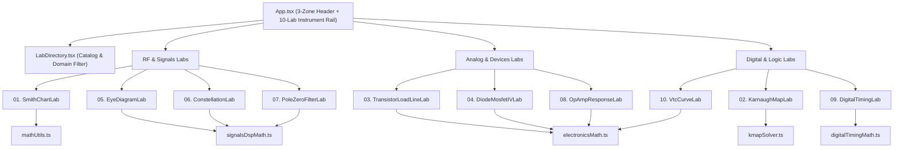

# CircuitBench Lab — Digital & Electronics Engineering Suite


An interactive, 100% client-side **Digital & Electronics Engineering Simulation Laboratory** featuring 10 deterministic physics, signal-integrity, DSP, and digital-logic instruments with zero external AI runtime calls.

---

## Included Engineering Instruments (10 Labs)

| # | Instrument | Domain | Core Capabilities |
| :--- | :--- | :--- | :--- |
| **01** | **Smith Chart** | RF & Transmission Lines | Interactive $\Gamma$-plane click probe & hover crosshair, admittance ($Y$) grid overlay, lumped $L/C/R$ + transmission line ($\lambda$) builder, analytic L-match & single-stub shunt solver, and saved exercise pool. |
| **02** | **Karnaugh Map (K-Map)** | Combinational Logic | 2- to 6-variable multi-plane Gray-code grid, synchronized truth table, direct $\Sigma m / \Pi M / d$ index list inputs, toroidal loop highlighting, and minimized SOP + POS Boolean expressions. |
| **03** | **Transistor Load-Line & Q-Point** | BJT Analog Biasing | Voltage-divider bias ($V_{CC}, R_1, R_2, R_C, R_E, \beta$), DC & AC load lines, collector curve family, Q-point & max undistorted voltage swing readouts, and real-time clipping waveform monitor with hover tooltips. |
| **04** | **Diode & MOSFET I–V Curves** | Semiconductor Physics | Shockley diode equation ($V_T$, dynamic $r_d$, $R_S$) and n-MOSFET $I_D$ vs. $V_{DS}$ curves showing Cutoff, Triode, Saturation, transconductance ($g_m$), output/on-resistance ($r_{on}$), and interactive probe tooltips. |
| **05** | **Eye Diagram** | Signal Integrity | High-speed PRBS NRZ & PAM4 link simulator with 1-pole channel bandwidth ISI, RJ + deterministic jitter (DJ), AWGN noise, Eye Height/Width, zero-crossing jitter, BER risk, and hover crosshair. |
| **06** | **Constellation Diagram (I/Q)** | Telecom Modulation | BPSK, QPSK, 16-QAM, and 64-QAM scatter plots with Voronoi boundaries, AWGN, carrier phase offset, EVM (% & dB), empirical vs. theoretical SER, phase/amplitude distortion, and I/Q probe tooltip. |
| **07** | **Pole–Zero Plot (z-Plane)** | Digital Filters (DSP) | Drag poles/zeros or type exact $(Re, \pm j)$ coordinates across the unit circle to inspect BIBO stability, passband/stopband attenuation, phase linearity, $h[n]$, and interactive plot tooltips. |
| **08** | **Op-Amp Frequency & GBW** | Analog Amplifiers | Log-frequency Bode plot comparing Open-Loop $A_{OL}(f)$ vs. Closed-Loop $A_{CL}(f)$ via $R_f/R_1$, $-3\text{ dB}$ & full-power bandwidth, loop gain margin, phase margin, slew distortion, and tooltips. |
| **09** | **Digital Timing Diagram** | Sequential Logic | Clock-frequency adjustable D, JK, T Flip-Flops and 4-bit Synchronous Counter showing output state sequence ($Q$), propagation delay $t_{pd}$, setup/hold violations, glitch detection, and cycle probe tooltips. |
| **10** | **BJT / CMOS VTC Curve** | Logic Thresholds | Inverter voltage transfer characteristic ($V_{out}$ vs. $V_{in}$) showing $V_{IL}, V_{IH}, V_M$, Noise Margins ($NM_L, NM_H$), transition gain, short-circuit current $I_{SC}$, and region hover tooltips. |

---

## Architecture Diagram



---

## Local Setup & Commands

```bash
# Install dependencies
npm install

# Start development server on port 3000
npm run dev

# Run TypeScript type check
npm run lint

# Run Vitest + React Testing Library automated suite
npm test

# Build production bundle for GitHub Pages
npm run build
```

---

## Automated Testing & CI/CD

- **Unit & Integration Tests**: `npm test` executes Vitest across all math/physics engines (`src/tests/*.test.ts`) and React Testing Library component flows (`src/tests/appIntegration.test.tsx`), covering both happy-path ("Blue Pill") and adversarial edge-case ("Red Pill") inputs.
- **GitHub Pages Deployment**: `.github/workflows/deploy.yml` runs tests, TypeScript linting, Vite build (`base: '/Circuit-Bench-Lab/'`), and deploys `./dist` to GitHub Pages on every push to `main` (requires `package-lock.json` committed for `npm ci --legacy-peer-deps`).
